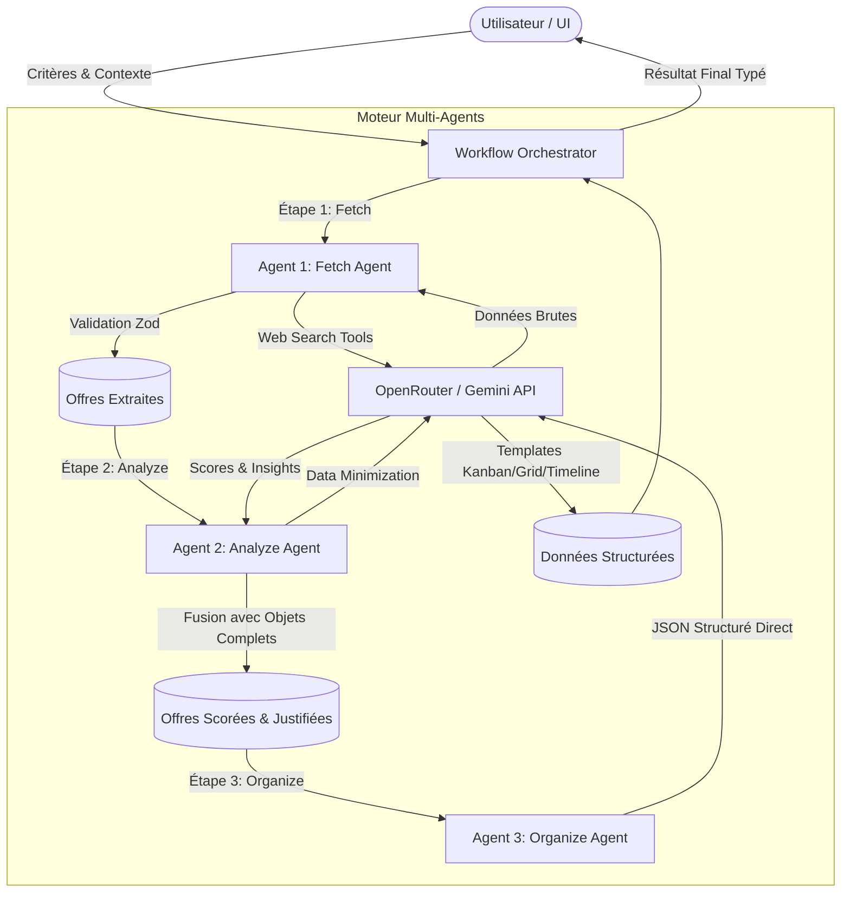

# 🤖 Agent.md — Guide Opérationnel & Manuel d'Architecture pour Agents IA

> **Document de Référence Officiel** destiné à tout Agent d'Assistance IA (Antigravity, Claude Code, Cursor, Copilot, Roo Code, etc.) intervenant sur le repository **OfferAnalyst**.
> Ce fichier définit la mission, les règles absolues d'ingénierie logicielle, l'architecture Next.js 16 / React 19, le moteur multi-agents interne et les protocoles de vérification.

---

## 📑 Sommaire
1. [🎯 Identité, Mission & Stack Technique](#1--identité-mission--stack-technique)
2. [⚡ Les 17 Règles Fondamentales Inviolables](#2--les-17-règles-fondamentales-inviolables)
3. [📁 Cartographie & Structure de la Codebase](#3--cartographie--structure-de-la-codebase)
4. [🧠 Système Multi-Agents Interne d'OfferAnalyst](#4--système-multi-agents-interne-dofferanalyst)
5. [🔐 Authentification (Better-Auth) & Sécurité BYOK](#5--authentification-better-auth--sécurité-byok)
6. [🗄️ Base de Données (Prisma & MongoDB) & Stockage](#6--base-de-données-prisma--mongodb--stockage)
7. [🔄 Flux d'Exécution : Server Actions & Validation Zod](#7--flux-dexécution--server-actions--validation-zod)
8. [🎨 Design System, UI/UX & Tailwind CSS Canonique](#8--design-system-uiux--tailwind-css-canonique)
9. [🛡️ Sécurité des Fichiers d'Environnement (.env)](#9--sécurité-des-fichiers-denvironnement-env)
10. [🧪 Commandes de Validation & Hygiène du Code](#10--commandes-de-validation--hygiène-du-code)
11. [📋 Protocole de Suivi & Mise à Jour des Tâches (SSOT: docs/TASKS.md)](#11--protocole-de-suivi--mise-à-jour-des-tâches-ssot-docstasksmd)

---

## 1. 🎯 Identité, Mission & Stack Technique

### 1.1 Présentation d'OfferAnalyst
**OfferAnalyst** est une plateforme SaaS de recommandation contextuelle augmentée par IA. Elle permet de rechercher, agréger, scorer, comparer et organiser des offres de marché (Immobilier, Emplois/Missions Freelance, SaaS, Startups, Hardware) à partir de critères explicites et de contextes implicites définis par l'utilisateur.

### 1.2 Stack Technologique Principale
| Domaine | Technologie | Spécificités & Rôle |
| :--- | :--- | :--- |
| **Framework** | Next.js 16 (App Router) | React Server Components (RSC) par défaut, Server Actions sécurisées |
| **Runtime & Lib** | React 19 + TypeScript 5.9 | Typage strict (`noEmit`), hooks modernes, compilation optimisée |
| **Styling** | Tailwind CSS v4 + PostCSS | Classes canoniques ordonnées, tokens CSS unifiés, dark mode natif |
| **UI Components** | shadcn/ui + Radix UI | Primitives accessibles, composants modulaires dans `@/components/ui` |
| **Animations** | Framer Motion v12 | Transitions fluides, micro-animations, feedbacks interactifs |
| **Visualisation** | Recharts v3 | Graphiques radar de scores, ventilations métriques, comparateurs |
| **ORM & BDD** | Prisma 6.2 + MongoDB Atlas | Client singleton, ObjectIds natifs, index optimisés |
| **Authentification** | Better-Auth 1.4 | Sessions chiffrées, adaptateur Prisma MongoDB, rôles RBAC |
| **Stockage Fichiers** | Tigris Data Storage | Compatible S3, URLs pré-signées, stockage d'offres et exports |
| **Tâches de Fond** | Upstash QStash & Redis | Queues asynchrones, webhooks signés, rate-limiting in-memory/Redis |
| **Emails** | Resend + React Email | Envois transactionnels asynchrones (délégation QStash) |
| **Moteur IA** | OpenRouter SDK / Google GenAI | Accès multi-modèles (Gemini 2.0 Flash, DeepSeek, Claude, GPT-4) |
| **Validation** | Zod 4 | Validation runtime stricte de chaque payload API, DB et action |

---

## 2. ⚡ Les 17 Règles Fondamentales Inviolables

Chaque agent IA opérant sur ce dépôt **DOIT RESPECTER SCRUPULEUSEMENT** ces directives :

1. **Architecture et Structure :** Utilisez les *React Server Components* (RSC) par défaut. Colocalisez vos composants près de leurs routes respectives. Centralisez les instances de clients partagés (Prisma, Cloud, Auth, Logger) dans un dossier `@/lib` dédié.
2. **Base de Données (Prisma & MongoDB) :** Utilisez obligatoirement le singleton pour le client Prisma (`@/lib/prisma`). Validez toutes les entrées via Zod avant tout envoi en base de données.
3. **Authentification (Better-Auth) :** Priorisez systématiquement les vérifications de session côté serveur (`await auth.api.getSession(...)`). Assurez-vous que `schema.prisma` et la configuration Better-Auth restent parfaitement synchronisés. Ne renvoyez JAMAIS de hash de mot de passe ni de token secret au client.
4. **Stockage d'Objets (Tigris) :** Utilisez exclusivement des URLs signées temporaires (S3-compatible). Programmez et gérez le nettoyage des fichiers orphelins ou supprimés via des jobs de fond.
5. **Gestion des Tâches Asynchrones (Upstash QStash) :** Vérifiez toujours la signature cryptographique des webhooks entrants (`receiver.verify`). Concevez des fonctions strictement idempotentes pour absorber les retries automatiques. Déchargez tous les processus lourds (emails, génération de rapports PDF, traitement par lots) vers QStash.
6. **Performance & Caching (Upstash Redis) :** Mettez en cache les requêtes de recherche coûteuses. Implémentez un Rate Limiting systématique sur les Server Actions sensibles (formulaires publics, analyses IA, authentification).
7. **Communication (Resend) :** Utilisez React Email pour composer des templates typés et réutilisables. N'envoyez JAMAIS d'email de manière synchrone bloquante dans le thread HTTP (passez systématiquement par un job asynchrone).
8. **Realtime & Synchronisation d'État :** Utilisez des souscriptions sélectives (colonnes et filtres ciblés). Combinez avec des *Optimistic Updates* côté client pour offrir une sensation de latence zéro.
9. **Typage et Sécurité :** Strict TypeScript obligatoire (zéro `any` non justifié). Validez les variables d'environnement au démarrage pour éliminer les crashs silencieux en production.
10. **Server Actions :** Utilisez systématiquement le pattern de retour unifié `{ success: true, data } | { success: false, error }` (ou `{ data, error }`). Déclenchez immédiatement `revalidatePath` ou `revalidateTag` après toute mutation de données.
11. **Proactivité UI :** Si un élément d'interface est manquant pour supporter une fonctionnalité backend, implémentez-le de manière logique et cohérente avec le design system actuel (shadcn/ui + Tailwind v4) pour garantir la continuité du flux utilisateur.
12. **Documentation et Commentaires :** Ne JAMAIS implémenter une fonctionnalité sans commenter le code de manière pertinente (JSDoc, explications des contraintes non triviales) et mettre à jour la documentation technique associée dans `docs/`.
13. **Hygiène du Code :** Bannissez les chemins relatifs profonds (`../../`) au profit exclusif de l'alias canonique `@/*`. Supprimez systématiquement les variables, types et imports inutilisés.
14. **Tailwind CSS Canonique :** Respectez l'ordre logique et canonique des classes Tailwind (Layout → Sizing/Spacing → Typography → Backgrounds/Borders → Effects → Transitions & States).
15. **Audit des Fichiers d'Environnement :** Détectez et analysez la présence de tous les fichiers `.env`, `.env.example`, `.env.local` avant de modifier des configurations d'infrastructure.
16. **Intégrité Absolue des `.env.*` :** Ne JAMAIS supprimer le contenu existant d'un fichier `.env.*`. Si une variable devient obsolète, commentez-la avec une note explicative (`# Deprecated: ...`). Préservez scrupuleusement les clés configurées.
17. **Vérification Systématique Avant Validation :** Exécutez toujours `npx tsc --noEmit` et `npm run lint` pour vous assurer qu'aucune régression ou erreur de build n'est introduite.

---

## 3. 📁 Cartographie & Structure de la Codebase

```
OfferAnalyst/
├── .agent/skills/               # 160+ skills spécialisés pour les agents IA
├── docs/                        # Documentation d'architecture & guides de déploiement
│   ├── AGENTS_ARCHITECTURE.md   # Spécifications détaillées des agents internes
│   ├── API_KEY_SECURITY.md      # Système de chiffrement AES-256-GCM BYOK
│   ├── MONGODB_SETUP.md         # Guide de configuration base MongoDB & Prisma
│   └── PREMIUM_DESIGN_SYSTEM.md # Tokens & directives esthétiques
├── prisma/
│   └── schema.prisma            # Modèles Prisma (MongoDB provider, @map("_id"))
├── public/                      # Assets statiques & icônes
├── src/
│   ├── app/                     # Next.js App Router
│   │   ├── (auth)/auth/         # Routes d'authentification (login, signup, reset)
│   │   ├── actions/             # Server Actions Next.js
│   │   │   ├── shared/          # agent-utils.ts, api-key-provider.ts
│   │   │   ├── workflow/        # orchestrator.ts (Machine à états)
│   │   │   ├── db/              # api-keys.ts, analytics.ts, security-alerts.ts
│   │   │   ├── fetchV2.ts       # Agent Fetch (Web Search + Extraction)
│   │   │   ├── analyzeV2.ts     # Agent Analyze (Scoring pondéré + Minimisation)
│   │   │   └── organizeV2.ts    # Agent Organize (Structuring JSON direct)
│   │   ├── dashboard/           # Tableau de bord principal
│   │   ├── projects/            # Gestion des espaces de recherche
│   │   ├── saved/               # Offres sauvegardées
│   │   ├── history/             # Historique des analyses
│   │   ├── compare/             # Comparateur côte-à-côte
│   │   ├── onboarding/          # Parcours d'accueil utilisateur
│   │   ├── layout.tsx           # Layout racine avec Providers
│   │   └── page.tsx             # Landing / Recherche contextuelle
│   ├── components/              # Composants React
│   │   ├── ui/                  # Primitives shadcn/ui (Button, Dialog, Card, etc.)
│   │   ├── offers/              # Cards d'offres, badges, scores radar
│   │   ├── forms/               # Formulaires de recherche & critères
│   │   └── layout/              # Navbar, Sidebar, Footer, ThemeToggle
│   ├── hooks/                   # Custom React Hooks
│   ├── lib/                     # Singletons & Services Centraux
│   │   ├── prisma.ts            # Singleton PrismaClient
│   │   ├── auth.ts              # Instance Better-Auth serveur
│   │   ├── auth-client.ts       # Client Better-Auth pour composants client
│   │   ├── api-key-encryption.ts# Chiffrement AES-256-GCM des clés BYOK
│   │   ├── api-key-manager.ts   # Rotation et gestion des priorités de clés
│   │   ├── rate-limiter.ts      # Rate limiter multicouche
│   │   ├── ai-models.ts         # Registre des modèles LLM supportés
│   │   ├── logger.ts            # Logger Pino structuré
│   │   └── utils.ts             # Utilitaire cn (clsx + tailwind-merge)
│   └── types/                   # Définitions TypeScript & Schémas Zod
│       └── index.ts             # Offer, ScoredOffer, UserProfile, AgentActionResult
├── .env.example                 # Modèle des variables d'environnement
├── middleware.ts                # Middleware Next.js de protection des routes
├── next.config.ts               # Configuration Next.js 16
├── package.json                 # Dépendances du projet
└── tsconfig.json                # Configuration stricte TypeScript
```

---

## 4. 🧠 Système Multi-Agents Interne d'OfferAnalyst

Le cœur applicatif repose sur une architecture multi-agents modulaire orchestrée via Server Actions.



### 4.1 Rôles & Contraintes Techniques des Agents

#### 1. Fetch Agent (`src/app/actions/fetchV2.ts`)
*   **Mission :** Interroger le web en temps réel selon le domaine et le profil de recherche.
*   **Contraintes API :** Utilise des `tools` de recherche web (`googleSearch`). En raison des contraintes de l'API avec tools, `responseMimeType: "application/json"` est désactivé.
*   **Stratégie de Résilience :** Extraction JSON manuelle par regex via `parseJSONFromText()`, suivie d'une validation runtime stricte via `OfferArraySchema` (Zod) et d'un retry exponentiel (`retryWithBackoff`).

#### 2. Analyze Agent (`src/app/actions/analyzeV2.ts`)
*   **Mission :** Calculer les scores de pertinence (0-100) basés sur 3 axes pondérables : Pertinence (`relevance`), Qualité (`quality`), et Tendance du marché (`trend`).
*   **Stratégie d'Optimisation des Tokens (Data Minimization) :** Pour éviter les dépassements de contexte ou les erreurs `No response text`, l'agent convertit les offres en `SimplifiedOffer` (troncature des descriptions à 500 caractères, suppression des métadonnées superflues). Après scoring par le LLM, les scores et justifications sont **re-fusionnés** avec les objets complets d'origine via leur identifiant unique (`id`).

#### 3. Organize Agent (`src/app/actions/organizeV2.ts`)
*   **Mission :** Regrouper et catégoriser les offres selon différents templates d'affichage (`grid`, `timeline`, `kanban`).
*   **Contraintes API :** Ne nécessite aucun tool de recherche. Peut exploiter le format direct `responseMimeType: "application/json"`.

#### 4. Orchestrateur (`src/app/actions/workflow/orchestrator.ts`)
*   Gère la machine à états : `pending` → `fetching` → `analyzing` → `organizing` → `complete` (ou `failed`, `cancelled`).
*   Supporte l'annulation en direct via `cancelWorkflow(workflowId)`.
*   Émet les progressions séquentielles pour alimenter l'interface utilisateur.

---

## 5. 🔐 Authentification (Better-Auth) & Sécurité BYOK

### 5.1 Architecture Better-Auth
*   **Fichier Serveur :** `src/lib/auth.ts`. Utilise `prismaAdapter` avec le provider MongoDB.
*   **Client React :** `src/lib/auth-client.ts` (`createAuthClient()`).
*   **Protection des Routes :** Le fichier `middleware.ts` filtre l'accès aux pages sensibles (`/dashboard`, `/saved`, `/history`, `/projects`, `/compare`, `/onboarding`) en vérifiant le cookie de session `offeranalyst.session_token`.
*   **Vérification Serveur :** Dans toute Server Action sécurisée, commencez impérativement par :
    ```typescript
    import { auth } from "@/lib/auth";
    import { headers } from "next/headers";

    const session = await auth.api.getSession({
        headers: await headers()
    });
    if (!session || !session.user) {
        return { success: false, error: { message: "Non autorisé", code: "UNAUTHORIZED" } };
    }
    ```

### 5.2 Système BYOK (Bring Your Own Key) & Chiffrement
*   Les utilisateurs peuvent fournir leurs propres clés d'API (OpenRouter, Gemini, Anthropic).
*   **Chiffrement à l'état de repos :** Algorithme **AES-256-GCM** implémenté dans `src/lib/api-key-encryption.ts`.
*   Chaque clé est stockée dans la collection `api_keys` sous forme chiffrée (`keyEncrypted`), accompagnée uniquement d'un aperçu public des 4 derniers caractères (`keyPreview`).
*   **Priorisation & Fallback :** `src/app/actions/shared/api-key-provider.ts` gère la récupération de la clé active la plus prioritaire de l'utilisateur, avec bascule transparente vers la clé système globale en cas d'absence.

---

## 6. 🗄️ Base de Données (Prisma & MongoDB) & Stockage

### 6.1 Règles Prisma MongoDB
*   **Singleton :** Toujours importer `prisma` depuis `@/lib/prisma`.
*   **Identifiants MongoDB :** Chaque modèle utilise `@id @default(auto()) @map("_id") @db.ObjectId`.
*   **Relations :** Utiliser des types `@db.ObjectId` pour toutes les clés étrangères (`userId String @db.ObjectId`).
*   **Champs JSON/Longs Textes :** Spécifier `@db.String` sur les champs volumineux (ex: métadonnées JSON, justifications).

### 6.2 Modèles Principaux (`prisma/schema.prisma`)
*   `User`, `Account`, `Session`, `VerificationToken` : Cœur Better-Auth.
*   `Profile` : Préférences utilisateur, thème, langue, étape d'onboarding.
*   `APIKey` & `APIKeyUsageLog` : Gestion des clés BYOK, rotation, audit d'utilisation et alertes.
*   `SavedOffer` : Sauvegarde des offres préférées.
*   `SearchHistory` : Historique des recherches contextuelles.
*   `Project` : Espaces de travail multi-sources.
*   `SecurityAlert` : Détection des anomalies (dépassements de rate-limit, clés expirées).

### 6.3 Stockage Objet (Tigris)
*   Tigris fournit une API compatible S3 (`TIGRIS_STORAGE_ENDPOINT`).
*   Générer des URLs pré-signées avec durée d'expiration courte pour l'accès aux fichiers privés.
*   Ne jamais persister de gros blobs binaires dans MongoDB.

---

## 7. 🔄 Flux d'Exécution : Server Actions & Validation Zod

Toutes les Server Actions doivent respecter le standard de retour suivant :

```typescript
'use server';

import { z } from 'zod';
import { prisma } from '@/lib/prisma';
import { revalidatePath } from 'next/cache';

// 1. Schéma Zod d'entrée
const InputSchema = z.object({
  projectId: z.string().min(1),
  name: z.string().min(3).max(100),
});

export type ActionResponse<T> = 
  | { success: true; data: T }
  | { success: false; error: { message: string; code?: string } };

export async function updateProjectAction(
  rawInput: unknown
): Promise<ActionResponse<{ id: string }>> {
  try {
    // 2. Validation stricte Zod
    const parsed = InputSchema.safeParse(rawInput);
    if (!parsed.success) {
      return {
        success: false,
        error: { message: "Données invalides", code: "VALIDATION_ERROR" },
      };
    }

    // 3. Exécution métier via Prisma Singleton
    const updated = await prisma.project.update({
      where: { id: parsed.data.projectId },
      data: { name: parsed.data.name },
      select: { id: true },
    });

    // 4. Revalidation immédiate du cache Next.js
    revalidatePath(`/projects/${parsed.data.projectId}`);
    revalidatePath('/projects');

    return { success: true, data: updated };
  } catch (error) {
    console.error('[updateProjectAction] Error:', error);
    return {
      success: false,
      error: { 
        message: error instanceof Error ? error.message : "Erreur inattendue",
        code: "INTERNAL_ERROR"
      },
    };
  }
}
```

---

## 8. 🎨 Design System, UI/UX & Tailwind CSS Canonique

### 8.1 Philosophie Visuelle ("Neon / Premium Dashboard")
*   **Palette :** Mode sombre par défaut élégant (ardoise profonde, bordures subtiles à 5-10% d'opacité, accents néon émeraude/cyan/indigo).
*   **Typographie :** Polices modernes sans-serif (Inter, Geist) avec hiérarchie claire.
*   **Proactivité UI :** Ne jamais laisser une action backend sans son retour visuel (Spinner, Skeleton, Toast d'erreur/succès, confirmation modale).

### 8.2 Ordre Canonique des Classes Tailwind CSS
Organisez toujours les classes selon l'ordre :
1. **Positionnement & Layout :** `relative`, `absolute`, `flex`, `grid`, `items-center`, `justify-between`
2. **Dimensions & Espacements :** `w-full`, `max-w-md`, `h-10`, `p-4`, `px-6`, `space-y-2`, `gap-4`
3. **Typographie :** `text-sm`, `font-semibold`, `tracking-tight`, `text-foreground`
4. **Fonds, Bordures & Formes :** `bg-card`, `bg-background/80`, `rounded-xl`, `border`, `border-border/40`
5. **Effets & Ombres :** `shadow-sm`, `shadow-emerald-500/10`, `backdrop-blur-md`
6. **Transitions & Pseudo-classes :** `transition-colors`, `hover:bg-accent`, `focus:ring-2`, `disabled:opacity-50`

---

## 9. 🛡️ Sécurité des Fichiers d'Environnement (.env)

| Fichier | Statut & Règle d'Édition |
| :--- | :--- |
| `.env` | **Critique :** Contient les configurations d'infrastructure et clés d'accès. **Ne jamais vider ni supprimer**. |
| `.env.local` | **Local :** Utilisé pour le dev local. **Ne jamais commiter dans git**. |
| `.env.example` | **Modèle Public :** Référence de toutes les variables nécessaires sans valeurs sensibles. |

> [!CAUTION]
> **Règle n°16 :** Lors de toute modification, NE SUPPRIMEZ AUCUNE CLÉ EXISTANTE. Si une variable n'est plus requise, commentez-la (ex: `# GEMINI_API_KEY=...`) et documentez la raison du changement.

---

## 10. 🧪 Commandes de Validation & Hygiène du Code

Avant d'annoncer la complétion d'une tâche, l'agent IA doit exécuter ces vérifications :

```bash
# 1. Vérification stricte des types TypeScript (Zéro erreur tolérée)
npx tsc --noEmit

# 2. Analyse statique ESLint
npm run lint
# ou
pnpm lint

# 3. Génération du client Prisma (en cas de modification de schema.prisma)
npx prisma generate

# 4. Validation du build de production Next.js
npm run build
# ou
pnpm build
```

---

## 11. 📋 Protocole de Suivi & Mise à Jour des Tâches (SSOT: docs/TASKS.md)

Afin d'éliminer la dispersion documentaire et de garantir un suivi rigoureux, **tous les agents IA doivent respecter le protocole suivant** :

### 11.1 Source Unique de Vérité (SSOT)
- **Interdiction formelle** de créer de nouveaux fichiers Markdown de suivi ponctuels (ex: `TODO_*.md`, `TICKET_*.md`, `SUMMARY_phaseX.md`) à la racine ou dans `docs/`.
- Tout le pilotage opérationnel (Kanban, backlog, critères d'acceptation, état) réside exclusivement dans :  
  👉 **[`docs/TASKS.md`](file:///c:/Users/hanok/Dev/Personal-Project/OfferAnalyst/docs/TASKS.md)**.
- Les anciens comptes-rendus de phases et tickets résolus sont préservés dans le dossier d'archives :  
  👉 **[`docs/archive/`](file:///c:/Users/hanok/Dev/Personal-Project/OfferAnalyst/docs/archive)**.

### 11.2 Rituel d'Exécution en 4 Étapes pour tout Agent IA
1. **Lecture préalable :** Consulter obligatoirement `docs/TASKS.md` pour récupérer l'identifiant normalisé de la tâche (ex: `TASK-AI-01`) et ses critères d'acceptation avant toute modification de code.
2. **Prise en charge :** Si le travail s'échelonne sur plusieurs tours, marquer la tâche avec `[-]` (En cours) dans le tableau Kanban de `docs/TASKS.md`.
3. **Validation & Clôture :** Une fois le code validé techniquement (`npx tsc --noEmit` & `npm run lint`), cocher les critères d'acceptation `[x]`, passer la tâche à `[x]`, et la consigner dans le tableau `Historique des Tâches Terminées` avec la date et les fichiers livrés.
4. **Journalisation Globale :** Pour les livraisons de fonctionnalités majeures ou corrections notables, consigner la synthèse dans [`CHANGELOG.md`](file:///c:/Users/hanok/Dev/Personal-Project/OfferAnalyst/CHANGELOG.md) suivant le format canonique *Keep a Changelog*.

---

*Fin du document — Document maintenu pour l'écosystème d'Agents Autonomes OfferAnalyst.*

