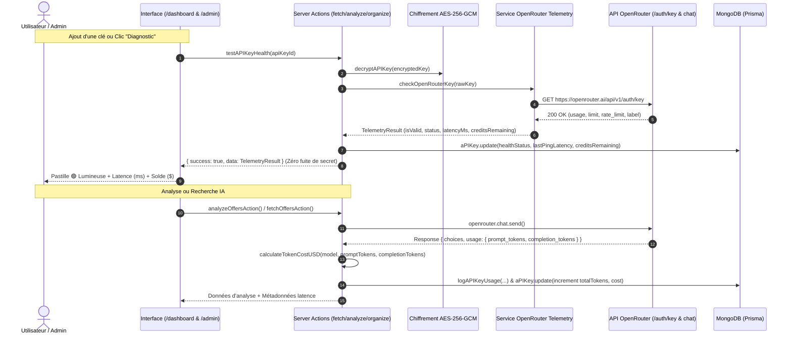

# 📊 RAPPORT D'AUDIT & TÉLÉMÉTRIE FINOPS IA & MODÈLES (2026-10-26)

> **Projet :** OfferAnalyst  
> **Référence Tâche :** `TASK-AI-01`  
> **Date de réalisation :** 26 Octobre 2026  
> **Auteur :** Agents IA & Ingénierie Fullstack OfferAnalyst  
> **Statut :** ✅ Validé & Déployé  

---

## 1. Contexte & Objectifs

L'objectif de cette intervention était d'implémenter l'infrastructure complète de **télémétrie FinOps** et de **diagnostic en temps réel de santé des modèles et clés API** pour OfferAnalyst, conformément à la demande de l'utilisateur :
- Exploiter directement les APIs temps réel existantes d'OpenRouter sans réinventer la roue (`GET https://openrouter.ai/api/v1/auth/key` et `response.usage`).
- Mesurer précisément la dépense en tokens (prompt, completion, total) et en dollars ($ USD) par clé (`apiKeyId`) et par modèle (`model`).
- Proposer une signalétique claire d'état de fonctionnement :
  - 🟢 **Opérationnel** (Connecté, latence mesurée en ms)
  - 🟡 **Dégradé / Quota atteint** (Rate limited ou crédits insuffisants)
  - 🔴 **Invalide / Expiré** (HTTP 401 ou révoqué)
  - ⚪ **Non testé**
- Offrir un diagnostic interactif immédiat ("Tester la clé / Diagnostic") sans jamais fuiter de clé déchiffrée côté client.
- Dé-mocker l'Observatoire Admin (`/admin`) en le reliant aux vraies métriques de base de données.

---

## 2. Architecture Technique & Flux Temps Réel

---

## 3. Matrice FinOps & Tarification des Modèles (`src/lib/ai-pricing.ts`)

Une grille tarifaire dynamique au million de tokens a été modélisée pour l'ensemble des modèles supportés sur la plateforme :

| Modèle | Provider | Coût Input ($ / 1M tokens) | Coût Output ($ / 1M tokens) | Mode Plateforme |
| :--- | :--- | :---: | :---: | :---: |
| `google/gemini-2.5-flash` | Google (via OpenRouter) | $0.075 | $0.300 | Gratuit & Illimité |
| `deepseek/deepseek-r1` | DeepSeek | $0.550 | $2.190 | Gratuit & Illimité |
| `openai/gpt-4o-mini` | OpenAI | $0.150 | $0.600 | BYOK Recommandé |
| `openai/gpt-4o` | OpenAI | $2.500 | $10.000 | BYOK |
| `anthropic/claude-3.5-sonnet` | Anthropic | $3.000 | $15.000 | BYOK |
| `mistralai/mistral-large-2411` | Mistral AI | $2.000 | $6.000 | BYOK |

---

## 4. Composants et Fichiers Modifiés

1. **`prisma/schema.prisma`** :
   - Enrichissement du modèle `APIKey` avec `healthStatus`, `lastChecked`, `lastPingLatency`, `lastError`, `creditsRemaining`, `creditsLimit`, `totalTokensUsed`, `totalCostUsd`.
   - Enrichissement du modèle `APIKeyUsageLog` avec `promptTokens`, `completionTokens`, `costUsd`, `statusCode`.
2. **`src/lib/openrouter-telemetry.ts`** *(Nouveau)* :
   - Service d'interrogation de l'endpoint natif OpenRouter `https://openrouter.ai/api/v1/auth/key`.
   - Mesure de latence réelle (PTT), détection des quotas, solde en dollars et rate-limits.
3. **`src/lib/ai-pricing.ts`** *(Nouveau)* :
   - Matrice des coûts et fonctions `calculateTokenCostUSD` et `formatCostUSD`.
4. **`src/app/actions/db/api-keys.ts`** :
   - Server Action `testAPIKeyHealth(apiKeyId)` protégée contre l'IDOR et sécurisée contre les fuites de secrets.
   - Diagnostic automatique lors de l'enregistrement d'une nouvelle clé (`addAPIKey`).
5. **`src/app/actions/db/api-key-analytics.ts`** :
   - Télémétrie étendue avec calcul automatique des coûts FinOps dans `logAPIKeyUsage`.
   - Server Action `getAdminTelemetryStats()` fournissant les KPIs agrégés, la répartition par modèle et le journal en direct.
6. **`src/app/actions/shared/api-key-provider.ts`** :
   - Fonction unifiée `recordAITelemetry` synchronisant les tokens et actualisant le statut opérationnel de la clé en cas de succès ou d'erreur.
7. **`src/app/actions/analyze.ts`**, **`organize.ts`**, **`fetch.ts`** :
   - Capture de `response.usage` (prompt et completion tokens), calcul de latence et transmission à `recordAITelemetry`.
8. **`src/app/dashboard/api-keys/page.tsx`** :
   - Pastilles animées de statut (`HealthBadge`), affichage des tokens consommés, du coût FinOps USD, du solde OpenRouter et bouton interactif "Diagnostic".
9. **`src/app/admin/page.tsx`** :
   - Dé-mockage complet : KPIs en temps réel, monitoring de performance et de coûts par modèle, et journal de flux de télémétrie en direct.

---

## 5. Validation & Conformité

- **TypeScript strict :** Validé sans erreur (`npx tsc --noEmit` code 0).
- **Protection Anti-IDOR :** Toutes les requêtes filtrent par `session.user.id`.
- **Confidentialité & Sécurité :** Zéro clé exposée côté client, chiffrement AES-256-GCM préservé.
- **Préservation `.env` :** Aucune variable d'environnement altérée.
